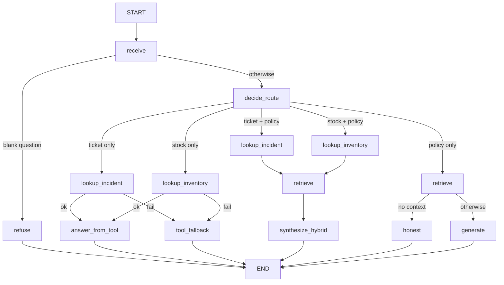

# Agent Graph — HealthCore Support Agent on LangGraph (Part 2)

## 1. Purpose

Route each coordinator question to the right source — stable **knowledge**
via RAG (`retrieve` + `generate_answer` in `data/pipelines/rag.py`) and live
**operational data** via read-only HTTP tools over the existing incidents API
(`GET /api/incidents`) and inventory API (`GET /inventory/products`).
Compiled LangGraph with single-responsibility nodes, conditional routing,
minimal state, queryable per-run traces, and checkpointing.

Part 1 delivered the RAG graph. Part 2 adds the tools (this document).

## 2. Flow



1. `POST /agent/query` calls `run_agent(question)` from
   `data/pipelines/agent_graph.py` and returns `result["answer"]`.
   `POST /knowledge/query` keeps serving legacy `query()` so both paths coexist.
   The backoffice Knowledge panel calls `/agent/query`.
2. `receive` normalizes the question; blank input short-circuits to `refuse`.
3. `decide_route` classifies from the question text alone (no user hint):
   - ticket/incident only → `incidents` (API tool only)
   - stock/SKU only → `inventory` (API tool only)
   - ticket/incident **and** policy signals → `hybrid_incidents` (tool then RAG)
   - stock/SKU **and** policy signals → `hybrid_inventory` (tool then RAG)
   - otherwise → RAG only
4. Tool nodes call typed helpers in `data/pipelines/agent_tools.py` only
   (HTTP GET against the live APIs, 5.0 s timeout, Bearer from env).
5. Hybrid path: `synthesize_hybrid` renders the deterministic tool fact block
   first, then appends the LLM policy paragraph — live status/stock is never
   left to the model to recall.
6. Each run stores a trace (`get_trace` / `get_last_trace`) and a checkpoint
   (`get_agent_state`).

## 3. State

```text
AgentState = {
  question: str,
  context: list[dict],
  answer: str,
  route: str,              # refuse | incidents | inventory | hybrid_* | rag
  tool_result: dict,       # serialized IncidentToolOutput | InventoryToolOutput
  sources_used: list[str], # execution order, e.g. ["incidents","rag"] on hybrid
  session_id: str,         # memory conversation scope (hito 26)
  memory_context: list[dict],  # approved agent-memory facts relevant to the question
  proposal: dict,          # candidate memory from the structured call ({} = none)
}
```

No conversation history, no vectors, no `trace_id` inside the state.
`session_id` / `memory_context` / `proposal` are set by the `run_agent`
memory orchestration (§10); the LLM nodes read `memory_context` and return
their candidate proposal in `proposal`.

## 4. Tools (Part 2)

The agent reaches the company tools through the **MCP server** (hito 25); the
table shows which MCP tool each node calls and the underlying API request the
MCP server performs with its own identity.

| Agent node | MCP tool | Underlying API call (made by the MCP server) | Writes |
|------------|----------|----------------------------------------------|--------|
| Incident lookup | `get_incident_status`, `list_incidents` | `GET /api/incidents/{id}`, `GET /api/incidents` (filters) | None |
| Inventory stock | `get_inventory_stock` | `GET /inventory/products` (by id / sku / name) | None |

### Contracts

- **Incident input:** `IncidentToolInput` — `ticket_id` and/or filters
  (`status`, `origin`, `branch`, `category`).
- **Incident output:** `IncidentToolOutput` — `ok`, `incidents[]`
  (`id`, `title`, `description`, `category`, `status`, `origin`, `branch`,
  `created_at`, `updated_at`), `error`, `message`.
- **Inventory input:** `InventoryToolInput` — `sku`, `name_query`, `supply_id`.
- **Inventory output:** `InventoryToolOutput` — `ok`, `products[]`
  (`id`, `name`, `sku`, `category`, `unit`, `country`, `current_stock`),
  `error`, `message`.

### Transport and auth

All tool traffic goes over **MCP** (Streamable HTTP) through
`data/pipelines/mcp_client.py`; the graph has no direct HTTP tool path. Auth is
a short-lived **service JWT** that the agent obtains itself through the OAuth2
client-credentials grant (`POST /auth/token` with `AGENT_TOOL_CLIENT_ID` /
`AGENT_TOOL_CLIENT_SECRET`), auto-renewed by
`data/pipelines/service_token_provider.py` — env/config, **never hardcoded**,
never a pasted human session (see §9.1). Timeouts, 404s, and transport failures
map to typed errors (`timeout` / `not_found` / `unavailable`) and honest
messages; the graph never hangs and never invents state.

### MCP transport (hito 25)

The two read-only lookups are MCP client calls
(`mcps/incidents-inventory-mcp`, Streamable HTTP) made by
`data/pipelines/mcp_client.py`:

- The agent mints its own service JWT (client-credentials grant) and presents it
  as the `Authorization` header of the MCP connection — never a baked-in token.
- The MCP server returns the **same tool contract** (`IncidentToolOutput` /
  `InventoryToolOutput`), so routing, spans, formatting and evals are unchanged;
  the node span records `transport: "mcp"`.
- Any MCP failure (server down, timeout, missing scope, non-contract payload)
  returns "no result" and the node answers with its honest message. The previous
  direct-`httpx` tools were **removed** for hito 25, so there is no second route
  to the Incidents Manager.
- `MCP_SERVER_URL` is the only switch: when empty, the hop cannot run and the
  node reports the honest `unavailable` contract (hermetic via
  `tests/pipelines/conftest.py`).

MCP tool calls need scopes: `incidents:read`, `inventory:read`. The agent
identity (`svc:langgraph-agent`) keeps only read scopes; write tools exist on
the server for tool-scoped callers, not for the agent (§9.1 scope policy is
unchanged).

### Fallbacks and honesty

On timeout, service error, missing ticket/product, or invalid input the graph
routes to `tool_fallback` (tool-only) or answers with the tool honesty message
inside `synthesize_hybrid` (hybrid). Fixed messages
(`INCIDENT_TOOL_FALLBACK`, `INVENTORY_TOOL_FALLBACK`,
`INCIDENT_NOT_FOUND_MESSAGE`, `INVENTORY_NOT_FOUND_MESSAGE`). Because the MCP
hop is the only path, an unavailable hop surfaces as the honest `unavailable`
message, and an auth rejection as `error="auth"` with
`INCIDENT_TOOL_AUTH_MESSAGE` / `INVENTORY_TOOL_AUTH_MESSAGE`, each plus a
warning log line — observable, never a silently invented answer (§9.1
criterion 5).

### Why not index tickets in RAG

Tickets and stock change in real time. RAG holds relatively stable policies
and procedures. A live API call always returns current operational data; an
indexed copy goes stale as soon as status or stock changes.

## 5. Node contract (binding)

- No node imports or calls the monolithic `query()` — enforced by AST test.
- `retrieve` never touches generation or tools; tool nodes never call RAG and
  never each other (single responsibility).
- `synthesize_hybrid` is the only node combining sources, and tool facts stay
  deterministic inside it.
- Nodes never read or write the memory store directly (hito 26): they receive
  `memory_context` through state and return their candidate `proposal`; all
  store I/O (pending, approval, consolidation, audit) happens in `run_agent`
  (§10).

## 6. Compilation and checkpointing

The graph is compiled at module import with a `MemorySaver` checkpointer.
`run_agent()` invokes with `thread_id == trace_id`.

## 7. Traces

Per run: `trace_id`/`thread_id`, timestamps, per-node spans in execution order,
**per-node output summaries**, `sources_used` (which sources ran and in what
order: RAG, tool, **or both**), `route`, totals, latency, error on failure.
Tool-node output summaries also carry `transport` (`mcp` or `http`), so a run
shows which tool path answered.

| Path | Example `sources_used` | Span order (core) |
|------|------------------------|-------------------|
| RAG only | `["rag"]` | `decide_route → retrieve → generate` |
| Tool only | `["incidents"]` | `decide_route → lookup_incident → answer_from_tool` |
| **Both (hybrid)** | `["incidents", "rag"]` | `lookup_incident → retrieve → synthesize_hybrid` |

Span outputs carry `source_kind` (`rag` / `incidents` / `inventory`).
Bounded in-memory store (last 100). HTTP contract unchanged:
`{question, answer}` only.

## 8. Evals

`tests/pipelines/test_agent_evals.py` evaluates **traces**, not live runs:

| Eval | Intent |
|------|--------|
| `eval_routes_to_tool_not_rag` | Ticket/stock question → its API tool, no RAG |
| `eval_routes_to_rag_not_tool` | Policy question → RAG, no API tool |
| `eval_routes_to_hybrid_tool_and_rag` | Policy+live question → tool **and** RAG, tool first, facts cited |
| `eval_tool_fallback_honesty` | API failure → `tool_fallback`, honest answer |
| Part 1 preds | routing order, blank short-circuit, empty-context honesty, grounding |

Golden fixtures in `tests/pipelines/fixtures/agent_traces/` plus generator
anti-rot tests. Live grounding still skipped unless `RUN_LIVE_EVALS=1`.

## 9. Gaps (TODO)

- TODO: decide trace/checkpoint persistence beyond memory if production review needs it.
- TODO: re-tune `min_score` after any corpus change (see `docs/rag/rag-design.md`).

### 9.1 Service identity for agent tools (implemented)

**Status:** Implemented on `feature/agent-tool-service-identity`
(2026-10-17). Accepted in instructor review the same day ("Ojo con el
token temporal: para producción tocaría sustituirlo por una identidad de
servicio").

**Previous state (retired).** `AGENT_TOOL_API_TOKEN` was a pasted user JWT
obtained via `POST /auth/login` and injected via `.env` → Compose
`env_file` → `os.getenv` in `data/pipelines/agent_tools.py`. When it
expired, `httpx` calls returned **401** and the graph routed to
`tool_fallback`, silently degrading all live tool routes while RAG routes
continued to work.

**Risks carried by the retired mechanism** (why this change was made):

1. **Silent degradation** — no alert when the token expired; live data
   quietly stopped until a human refreshed the env var.
2. **Audit attribution** — every tool call was attributed to the human
   user account (`sub=11`), not the agent service (HIPAA-adjacent
   human-vs-machine distinction broken).
3. **Manual rotation** — login → edit `.env` → recreate backend.
4. **Blast radius** — the token carried the full session rights of its
   user account, not just the two read-only lookups the agent needs.

**Delivered mechanism.**

- **Token grant.** `POST /auth/token` (OAuth2 client-credentials) issues a
  short-lived JWT (`typ=service`, `sub=svc:langgraph-agent`, TTL
  `SERVICE_TOKEN_EXPIRE_MINUTES`, default 15 min) signed **RS256** with the
  API's OAuth signing key (public key at `/.well-known/jwks.json`, hito 25).
- **Client registry.** `scripts/seed_service_client.py` registers the
  machine client in TinyDB `service_clients` (bcrypt-hashed secret);
  re-running rotates the secret and prints it once.
- **Agent-side renewal.** `data/pipelines/service_token_provider.py` holds
  an in-process cache with a 120 s refresh margin; if a renewal fails but
  the current token is still valid it keeps serving it (grace), and
  returns `None` once past absolute expiry. The secret can come from a
  mounted Docker secret (`AGENT_TOOL_CLIENT_SECRET_FILE`) so credential
  material never needs to live in a developer `.env`.
- **Scope enforcement.** The four read GET routes
  (`GET /api/incidents[/{id}]`, `GET /inventory/products[/{id}]`) accept
  humans via `get_current_user` or the service principal via
  `require_scope("incidents:read" | "inventory:read")`. Every other route
  stays human-only: `get_current_user` rejects `typ=service` → 401
  (fail-closed for free).
- **Attribution.** Dependencies write `request.state.principal`
  (`user:<id>` / `svc:<client_id>`); the API timing middleware logs it as
  `principal=…` in every `api.timing` record.
- **Observable expiry.** Tool 401/403 responses map to typed
  `error="auth"` with `INCIDENT_TOOL_AUTH_MESSAGE` /
  `INVENTORY_TOOL_AUTH_MESSAGE` plus a warning log — the span shows the
  auth error explicitly; it is never a silent fallback-only path.

**Acceptance criteria.**

- [x] Agent tools authenticate with a principal that is not a human user
      account (`svc:langgraph-agent` via client-credentials grant).
- [x] Credentials are renewed automatically; no manual env edit required
      for > 24 h of continuous operation (15 min TTL, in-process renewal).
- [x] API access logs attribute tool calls to the service principal
      (`principal=svc:langgraph-agent` in `api.timing`).
- [x] Tool scope is limited to the two read-only GET routes above
      (scope enforcement + `typ=service` rejected everywhere else).
- [x] Expiry of tool credentials is observable (explicit `error="auth"`
      span + warning log), never a silent fallback-only path.

**Non-goals.** Write access for the agent; cross-service impersonation;
changing the HTTP transport (`httpx` remains the chosen client).

**Remaining TODO (production pass).** Client-secret rotation is still
manual (re-run the seed script and update the secret). The
`service_clients` registry lives in `auth.json`, which has no persistent
volume in prod Compose — a backend recreate wipes it and the seed must be
re-run before the agent can authenticate again.

### 9.2 §9.1 superseded: the agent now uses MCP only (hito 25, implemented)

**Status:** Implemented on `feature/mcp-oauth-tools` (2026-10-17/18).

§9.1 listed "changing the HTTP transport (`httpx` remains the chosen client)" as
a non-goal. The MCP milestone supersedes that: the two read-only lookups are MCP
client calls and the direct-`httpx` tools were **removed** — one path only.

| §9.1 element | Status after hito 25 |
|---|---|
| Agent identity `svc:langgraph-agent`, client-credentials, 15 min TTL | Unchanged (the token presented to the MCP server) |
| Agent scope (read-only: `incidents:read`, `inventory:read`) | Unchanged — the agent cannot write through any transport |
| Automatic renewal, grace on renewal failure | Unchanged; the provider is shared and accepts a credential prefix |
| Unavailable/rejected tool in spans | Honest `unavailable` contract + warning log; no fallback route hides it |
| `httpx` direct tools | **Removed** (no dual path); MCP is the only transport |
| Write routes human-only at the API | Unchanged; the MCP server's own identity holds `incidents:write` for its incident tools, and inventory stays read-only at every layer |

**MCP resource server (new).** `mcps/incidents-inventory-mcp` is an OAuth 2.1
resource server via **MCP Auth** (`mcpauth`): RFC 9728 metadata at
`/.well-known/oauth-protected-resource/mcp`, `401` with
`WWW-Authenticate: … resource_metadata=…`, RS256 JWKS verification against the
HealthCore API issuer (`iss` + RFC 8707 `aud`), and scopes enforced **per tool**
(fail-closed). It reaches the API as `svc:mcp-server`
(`scripts/seed_service_client.py --client-id mcp-server --env-prefix
MCP_BACKEND`). `MCP_AUTH_JWKS_URI` overrides only the JWKS URL so the `mcp`
container can verify tokens while `iss` stays the public issuer. Full design and
rubric mapping: `docs/mcp/mcp-server.md`.

**Acceptance evidence (2026-10-18, live stack).**
`run_agent("What is the status of ticket 1?")` and
`run_agent("Do we have stock of HCR-PPE-001?")` both answered with real data and
recorded `transport: "mcp"` (in-network and host-side); `tools/list` returned the
6 tools; `update_inventory_stock` returned `inventory_write_denied`; a read-only
token calling `create_incident`/`update_incident_status` was denied
`insufficient_scope: missing incidents:write`; no-token/garbage/wrong-`aud`
requests returned distinct `401` codes; `scripts/mcp_playground_runbook.sh
preflight` passed. Audit logs record `tool= client= result= ms=` per call.

**Known gaps (production pass).**

- Client-credentials only: no authorization-code flow and no RFC 7523 client
  authentication.
- `unregister_service_client()` revokes the registry entry, but tokens already
  issued stay valid until their TTL.
- The `mcp` service has no persistent secrets volume in prod Compose: its
  `MCP_BACKEND_CLIENT_SECRET` is read from `.env`; prefer
  `MCP_BACKEND_CLIENT_SECRET_FILE` when a secret store exists. The container also
  needs a restart policy (it exits when it starts before the API is reachable for
  discovery).
- MCP Playground session against the public Codespaces URL: **done**
  (2026-10-18) — 6/6 tool flows, controlled inventory-write refusal, lifecycle
  rejection and 401 evidence in
  `docs/mcp/evidence/playground-session-2026-10-18.md`.

## 10. Agent memory (hito 26, Part 1)

Persistent, user-confirmed operational memory for the agent — a separate
namespace in the store, never a write path into RAG. The full loop evidence
(live transcripts of the approved and rejected cycles) is in
`docs/memory/evidence/agent-memory-evidence.md`; the store and PHI modules are
`data/pipelines/agent_memory.py` and `data/pipelines/memory_phi_guard.py`.

### Loop

`run_agent(question, session_id=...)` orchestrates the loop around the
existing graph (no new nodes), so spans and eval contracts stay intact:

1. `session_id` defaults to `f"user:{current_user.id}"` at the API layer
   (`services/app/routers/agent.py`); `AgentQueryRequest` may carry one
   explicitly (`services/app/schemas.py`).
2. Before invoking the graph, the pending proposal for the session (if any) is
   resolved against the new message by `classify_decision`
   (`approve` / `edit` / `reject` / `unrelated`) — silence, ambiguity or a
   topic change counts as a rejection and is audited as `default_rejected`.
3. Approved facts are re-screened for PHI, then consolidated into the store
   (dedupe + per-bucket cap); rejected proposals leave the store unchanged but
   the decision is audited.
4. `select_relevant()` loads approved facts into `memory_context`; the
   generation nodes include them in the prompt via
   `build_prompt(..., memory=...)` and return a candidate `proposal` from the
   single structured call (`generate_answer_with_proposal` in
   `data/pipelines/rag.py` — answer + `propuesta_memoria` in one call).
5. The proposal is PHI-screened before it is shown; clean proposals are asked
   inside the same answer (`PROPOSAL_QUESTION_ES` / `_EN`), PHI proposals are
   refused explicitly with reason codes only (matched text is never stored).

### Safety and retention

- **PHI gate** (`memory_phi_guard.py`): deterministic screen, applied before
  showing a proposal, before storing an approved/edited fact, and again at
  consolidation. Reason codes only in the audit.
- **Audit**: every outcome (`proposed`, `approved`, `edited`, `rejected`,
  `default_rejected`, `expired_default_rejected`, `rejected_phi`) is recorded
  with the decision label and reason codes.
- **Retention** (env knobs, defaults in `.env.example`): entry TTL 180 days,
  20 entries per clinic+category bucket, audit ring buffer of 1000 records
  (90-day sliding retention), pending proposals expire after 7 days. CLI:
  `python -m data.pipelines.agent_memory consolidate|audit`.
- **Store separation**: keys live under `agent:memory:*` only
  (`_assert_agent_namespace`); Qdrant `healthcore_knowledge` is read-only.

### Backends and config

`AGENT_MEMORY_BACKEND` selects the backend: `memory` (in-process, the default
outside Compose) or `redis` (Compose default, `redis>=5`,
`services/requirements.txt`). The Redis client is injectable, so the store
behaviour is unit-tested without a server
(`tests/pipelines/test_agent_memory.py`).

### Tests and evidence

- `tests/pipelines/test_agent_memory.py` — store, consolidation, TTL/cap,
  PHI screen, namespace guard, proposer/decision parsing fallbacks.
- `tests/pipelines/test_agent_graph_memory.py` — end-to-end loop with the
  LLM seams scripted (approve/reject/silence, PHI refusal, Spanish prompts,
  memory-context injection, audit and trace block).
- Offline demo: `uv run python scripts/agent_memory_demo.py`.
- Suites: `tests/pipelines/` 203 passed, 1 skipped; full repo 312 passed,
  1 skipped (2026-10-18).
