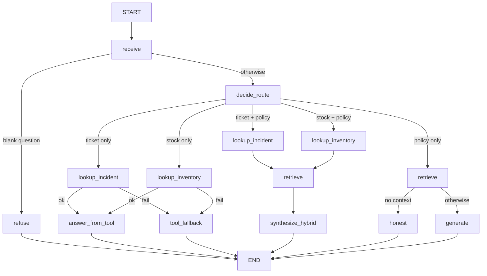

# Agent Graph — HealthCore Support Agent on LangGraph (Part 2)

## 1. Purpose

Route each coordinator question to the right source — stable **knowledge**
via RAG (`retrieve` + `generate_answer` in `data/pipelines/rag.py`) and live
**operational data** via read-only HTTP tools over the existing incidents API
(`GET /api/incidents`) and inventory API (`GET /inventory/products`).
Compiled LangGraph with single-responsibility nodes, conditional routing,
minimal state, queryable per-run traces, and checkpointing.

Part 1 delivered the RAG graph. Part 2 adds the tools (this document).

## 2. Flow



1. `POST /agent/query` calls `run_agent(question)` from
   `data/pipelines/agent_graph.py` and returns `result["answer"]`.
   `POST /knowledge/query` keeps serving legacy `query()` so both paths coexist.
   The backoffice Knowledge panel calls `/agent/query`.
2. `receive` normalizes the question; blank input short-circuits to `refuse`.
3. `decide_route` classifies from the question text alone (no user hint):
   - ticket/incident only → `incidents` (API tool only)
   - stock/SKU only → `inventory` (API tool only)
   - ticket/incident **and** policy signals → `hybrid_incidents` (tool then RAG)
   - stock/SKU **and** policy signals → `hybrid_inventory` (tool then RAG)
   - otherwise → RAG only
4. Tool nodes call typed helpers in `data/pipelines/agent_tools.py` only
   (HTTP GET against the live APIs, 5.0 s timeout, Bearer from env).
5. Hybrid path: `synthesize_hybrid` renders the deterministic tool fact block
   first, then appends the LLM policy paragraph — live status/stock is never
   left to the model to recall.
6. Each run stores a trace (`get_trace` / `get_last_trace`) and a checkpoint
   (`get_agent_state`).

## 3. State

```text
AgentState = {
  question: str,
  context: list[dict],
  answer: str,
  route: str,              # refuse | incidents | inventory | hybrid_* | rag
  tool_result: dict,       # serialized IncidentToolOutput | InventoryToolOutput
  sources_used: list[str], # execution order, e.g. ["incidents","rag"] on hybrid
}
```

No conversation history, no vectors, no `trace_id` inside the state.

## 4. Tools (Part 2)

| Tool | Call | Timeout | Writes |
|------|------|---------|--------|
| Incident lookup | `GET /api/incidents/{id}` or `GET /api/incidents` (filters) | **5.0 s** | None |
| Inventory stock | `GET /inventory/products/{id}` or `GET /inventory/products` | **5.0 s** | None |

### Contracts

- **Incident input:** `IncidentToolInput` — `ticket_id` and/or filters
  (`status`, `origin`, `branch`, `category`).
- **Incident output:** `IncidentToolOutput` — `ok`, `incidents[]`
  (`id`, `title`, `description`, `category`, `status`, `origin`, `branch`,
  `created_at`, `updated_at`), `error`, `message`.
- **Inventory input:** `InventoryToolInput` — `sku`, `name_query`, `supply_id`.
- **Inventory output:** `InventoryToolOutput` — `ok`, `products[]`
  (`id`, `name`, `sku`, `category`, `unit`, `country`, `current_stock`),
  `error`, `message`.

### Transport and auth

Tools call the APIs over **HTTP** (`httpx`) at `AGENT_TOOL_API_URL`
(default `http://127.0.0.1:8000`, overridable; Compose passes it through to
`backend`). Auth is a valid Bearer JWT from `AGENT_TOOL_API_TOKEN`
(env/config — **never hardcoded**). Timeouts, 404s, and transport/auth
failures map to typed errors (`timeout` / `not_found` / `unavailable`) and
honest fallbacks; the graph never hangs and never invents state.

### Fallback

On timeout, service error, missing ticket/product, or invalid input the graph
routes to `tool_fallback` (tool-only) or answers with the tool honesty message
inside `synthesize_hybrid` (hybrid). Fixed messages
(`INCIDENT_TOOL_FALLBACK`, `INVENTORY_TOOL_FALLBACK`,
`INCIDENT_NOT_FOUND_MESSAGE`, `INVENTORY_NOT_FOUND_MESSAGE`).

### Why not index tickets in RAG

Tickets and stock change in real time. RAG holds relatively stable policies
and procedures. A live API call always returns current operational data; an
indexed copy goes stale as soon as status or stock changes.

## 5. Node contract (binding)

- No node imports or calls the monolithic `query()` — enforced by AST test.
- `retrieve` never touches generation or tools; tool nodes never call RAG and
  never each other (single responsibility).
- `synthesize_hybrid` is the only node combining sources, and tool facts stay
  deterministic inside it.

## 6. Compilation and checkpointing

The graph is compiled at module import with a `MemorySaver` checkpointer.
`run_agent()` invokes with `thread_id == trace_id`.

## 7. Traces

Per run: `trace_id`/`thread_id`, timestamps, per-node spans in execution order,
**per-node output summaries**, `sources_used` (which sources ran and in what
order: RAG, tool, **or both**), `route`, totals, latency, error on failure.

| Path | Example `sources_used` | Span order (core) |
|------|------------------------|-------------------|
| RAG only | `["rag"]` | `decide_route → retrieve → generate` |
| Tool only | `["incidents"]` | `decide_route → lookup_incident → answer_from_tool` |
| **Both (hybrid)** | `["incidents", "rag"]` | `lookup_incident → retrieve → synthesize_hybrid` |

Span outputs carry `source_kind` (`rag` / `incidents` / `inventory`).
Bounded in-memory store (last 100). HTTP contract unchanged:
`{question, answer}` only.

## 8. Evals

`tests/pipelines/test_agent_evals.py` evaluates **traces**, not live runs:

| Eval | Intent |
|------|--------|
| `eval_routes_to_tool_not_rag` | Ticket/stock question → its API tool, no RAG |
| `eval_routes_to_rag_not_tool` | Policy question → RAG, no API tool |
| `eval_routes_to_hybrid_tool_and_rag` | Policy+live question → tool **and** RAG, tool first, facts cited |
| `eval_tool_fallback_honesty` | API failure → `tool_fallback`, honest answer |
| Part 1 preds | routing order, blank short-circuit, empty-context honesty, grounding |

Golden fixtures in `tests/pipelines/fixtures/agent_traces/` plus generator
anti-rot tests. Live grounding still skipped unless `RUN_LIVE_EVALS=1`.

## 9. Gaps (TODO)

- TODO: decide trace/checkpoint persistence beyond memory if production review needs it.
- TODO: re-tune `min_score` after any corpus change (see `docs/rag/rag-design.md`).

### 9.1 Proposed improvement — Service identity for agent tools

**Status:** Accepted in instructor review (2026-10-17). Out of scope for this
milestone; tracked here as the design baseline for a production hardening pass.

**Current state.** `AGENT_TOOL_API_TOKEN` is a pasted user JWT obtained via
`POST /auth/login` and injected via `.env` → Compose `env_file` → `os.getenv`
in `data/pipelines/agent_tools.py`. Expiry is governed by
`ACCESS_TOKEN_EXPIRE_MINUTES` (default **30**, see `services/app/core/security.py:18`).
When the token expires, `httpx` calls return **401** and the graph routes to
`tool_fallback`, producing an honest "could not confirm" answer instead of
live data. This was reproduced end-to-end: a UI battery ran within the token
window (live `status=open`, `current_stock=1289`); a later run after expiry
degraded all tool routes to fallback while RAG routes continued to work.

**Risks carried by the current mechanism.**

1. **Silent degradation.** No alert fires when the tool token expires; the
   agent quietly stops delivering live ticket/stock data until a human
   notices and refreshes the env var.
2. **Audit attribution.** API access logs attribute every tool call to the
   human user account (`sub=11`), not to the agent service. In a HIPAA-adjacent
   environment this breaks the human-vs-machine access distinction.
3. **Manual rotation.** Refreshing the token requires: login → edit `.env` →
   recreate backend. No automated lifecycle.
4. **Blast radius.** The token carries the full session rights of its user
   account; if leaked it grants everything that user can reach, not just
   read-only incident/inventory lookups.

**Proposed direction.** Replace the pasted user JWT with a dedicated machine
principal (service identity) that:

- Obtains and renews its own credentials automatically (OAuth2
  *client-credentials* flow, or an internal service key minted by the
  backend at startup and rotated on a schedule).
- Holds a **read-only, resource-scoped** grant limited to
  `GET /api/incidents[/{id}]` and `GET /inventory/products[/{id}]` —
  nothing more.
- Is attributable in every API log as a distinct principal (e.g.
  `svc:langgraph-agent`), never as a human user.
- Survives > 24 h without human intervention; credential material never
  appears in developer `.env` files.

**Acceptance criteria (production pass).**

- [ ] Agent tools authenticate with a principal that is not a human user
      account.
- [ ] Credentials are renewed automatically; no manual env edit required
      for > 24 h of continuous operation.
- [ ] API access logs attribute tool calls to the service principal.
- [ ] Tool scope is limited to the two read-only GET routes above.
- [ ] Expiry of tool credentials is observable (alert or explicit error
      span), never a silent fallback-only path.

**Non-goals.** Write access for the agent; cross-service impersonation;
changing the HTTP transport (`httpx` remains the chosen client).
