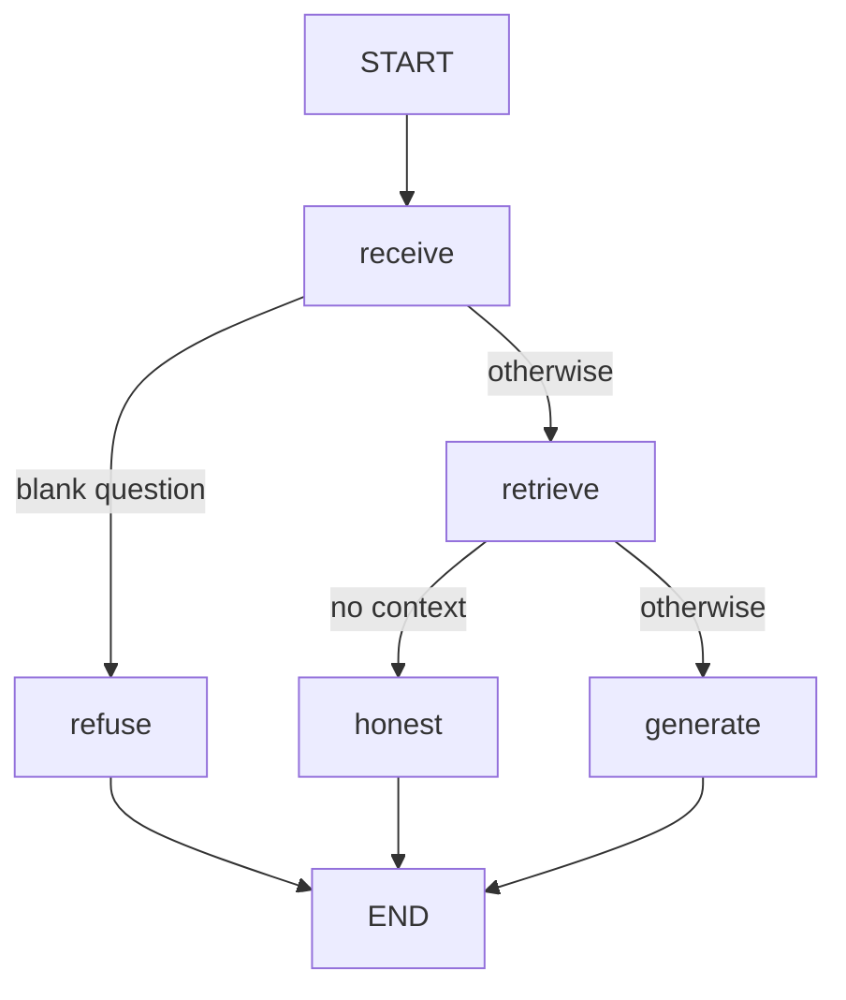

# Agent Graph — HealthCore Knowledge Assistant on LangGraph

## 1. Purpose

Make the RAG reasoning flow explicit: same behavior as `query()` in
`data/pipelines/rag.py`, but running inside a compiled LangGraph with
single-responsibility nodes, explicit conditional edges, a minimal state,
queryable per-run traces, and checkpointing. No new capabilities in this pass
(Part 2 adds tools as new nodes + edges).

## 2. Flow

1. `POST /agent/query` calls `run_agent(question)` from
   `data/pipelines/agent_graph.py` and returns `result["answer"]`.
   `POST /knowledge/query` keeps serving legacy `query()` so both paths coexist.
2. `receive` normalizes the question; blank input short-circuits to `refuse`
   (honest fallback, no retrieval, no LLM).
3. `retrieve` calls ONLY `retrieve(question)` from `data/pipelines/rag.py`.
4. `generate` calls ONLY `generate_answer(question, context)` with the
   already-retrieved context. Empty retrieval routes to `honest`, which answers
   via the existing empty-context path `generate_answer(question, [])`.
5. Each run stores a trace (`get_trace(trace_id)` / `get_last_trace()`) and a
   checkpoint (`get_agent_state(trace_id)`).

## 3. State

`AgentState = {question: str, context: list[dict], answer: str}` — nothing else.
No conversation history, no vectors, no scores, no `trace_id` inside the state.
`k` / `min_score` stay as retrieval defaults, not state fields.

## 4. Node contract (binding)

- No node imports or calls the monolithic `query()` — it takes only a question
  and would re-run retrieval, collapsing the explicit flow. Enforced by an AST
  test in `tests/pipelines/test_agent_graph.py`.
- `retrieve` never touches generation; `generate`/`honest` never touch
  retrieval. End-to-end test asserts `retrieve` runs exactly once per run.

## 5. Compilation and checkpointing

The graph is compiled at module import with a `MemorySaver` checkpointer
(`graph = builder.compile(checkpointer=...)`), so structural errors fail fast
instead of in production. `run_agent()` invokes with
`thread_id == trace_id`, making each run inspectable (and re-runnable from its
checkpoint) via `graph.get_state(config)` / `get_agent_state(trace_id)`.

## 6. Traces

Per run: `trace_id`/`thread_id`, timestamps, per-node spans in execution order,
**per-node output summaries** (`receive→question_chars`,
`retrieve→{n_chunks, sources}`, `generate/honest→answer_chars`,
`refuse→reason`), totals, latency, and error on failure. Bounded in-memory
store (last 100). The HTTP contract is unchanged (`{question, answer}` only —
never chunks or scores; no PHI at any point per HIPAA / UK GDPR).

## 7. Evals

`tests/pipelines/test_agent_evals.py` (single command) evaluates **traces**,
not live runs: pure predicates over trace dicts against golden fixtures in
`tests/pipelines/fixtures/agent_traces/` (routing order, blank short-circuit,
empty-context honesty, KB grounding on the $50 USD / £40 GBP cancellation fact),
plus generator tests proving fresh mocked runs satisfy the same predicates, plus
a live grounding eval (skipped unless `RUN_LIVE_EVALS=1`). Evals are additional
to the existing RAG tests, which keep passing unchanged.

## 8. Adding a tool (Part 2 preview)

Add a node plus a conditional edge deciding when to route to it. Existing
nodes and endpoints stay untouched.

## 9. Gaps (TODO)

- TODO: decide trace/checkpoint persistence beyond memory (file/DB) if production review needs it.
- TODO: re-tune `min_score` after any corpus change (see `docs/rag/rag-design.md`).
