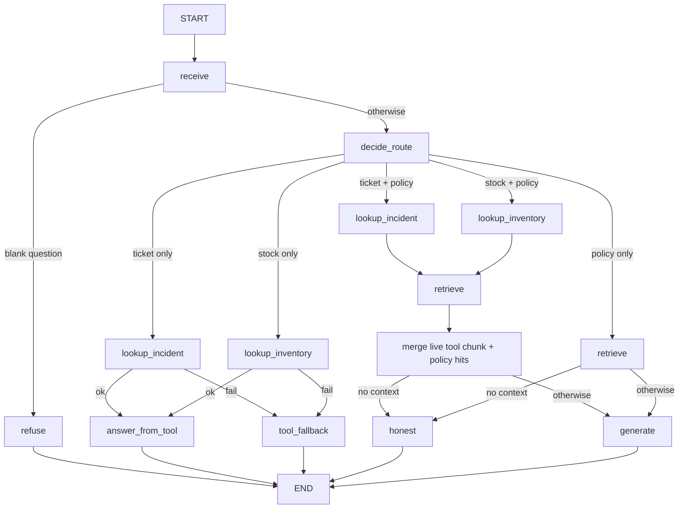

# Agent Graph — HealthCore Knowledge Assistant on LangGraph

## 1. Purpose

Make the support-agent reasoning flow explicit: stable **knowledge** via RAG
(`retrieve` + `generate_answer` in `data/pipelines/rag.py`) and live
**operational data** via read-only tools over the existing incident manager and
inventory services. Compiled LangGraph with single-responsibility nodes,
conditional routing, minimal state, queryable per-run traces, and checkpointing.

Part 1 delivered the RAG graph. Part 2 adds external tools (this document).

## 2. Flow



1. `POST /agent/query` calls `run_agent(question)` from
   `data/pipelines/agent_graph.py` and returns `result["answer"]`.
   `POST /knowledge/query` keeps serving legacy `query()` so both paths coexist.
2. `receive` normalizes the question; blank input short-circuits to `refuse`
   (honest fallback, no retrieval, no LLM, no tools).
3. `decide_route` classifies the question from its text alone (no user hint):
   - ticket/incident only → `incidents` (tool only)
   - stock/SKU only → `inventory` (tool only)
   - ticket/incident **and** policy signals → `hybrid_incidents` (tool then RAG)
   - stock/SKU **and** policy signals → `hybrid_inventory` (tool then RAG)
   - otherwise → RAG only
4. Tool nodes call typed helpers in `data/pipelines/agent_tools.py` only.
5. Hybrid path: tool first (live facts), then `retrieve`; the live tool result is
   injected as a context chunk (`live-incident-tool` / `live-inventory-tool`)
   ahead of policy hits so `generate` never invents ticket status or stock.
6. Tool-only path: `answer_from_tool` or `tool_fallback` (no RAG).
7. Each run stores a trace (`get_trace` / `get_last_trace`) and a checkpoint
   (`get_agent_state`).

## 3. State

```text
AgentState = {
  question: str,
  context: list[dict],
  answer: str,
  route: str,              # refuse | incidents | inventory | hybrid_* | rag
  tool_result: dict,       # serialized IncidentToolOutput | InventoryToolOutput
  sources_used: list[str], # execution order, e.g. ["incidents","rag"] on hybrid
}
```

No conversation history, no vectors, no `trace_id` inside the state.

## 4. Tools (Part 2)

| Tool | Module | Real backend | Timeout | Writes |
|------|--------|--------------|---------|--------|
| Incident lookup | `lookup_incident` | `incident_manager_service.get_incident` / `list_incidents` (TinyDB, same store as `GET /api/incidents`) | **5.0 s** | None (GET only) |
| Inventory stock | `lookup_inventory` | `inventory_service.list_supplies` / `get_supply` (SQLModel, same as `GET /inventory/products`) | **5.0 s** | None (GET only) |

### Contracts

- **Incident input:** `IncidentToolInput` — `ticket_id` and/or filters
  (`status`, `origin`, `branch`, `category`).
- **Incident output:** `IncidentToolOutput` — `ok`, `incidents[]`
  (`id`, `title`, `description`, `category`, `status`, `origin`, `branch`,
  `created_at`, `updated_at`), `error`, `message`.
- **Inventory input:** `InventoryToolInput` — `sku`, `name_query`, and/or
  `supply_id`.
- **Inventory output:** `InventoryToolOutput` — `ok`, `products[]`
  (`id`, `name`, `sku`, `category`, `unit`, `country`, `current_stock`),
  `error`, `message`.

### Transport and auth

Tools run **in-process** against the domain layer (same monorepo package as the
FastAPI app). They do not open HTTP to localhost and do not pass a JWT: public
HTTP routes remain Bearer-protected; the tool path is backend-internal
read-only. No tokens are hardcoded.

### Fallback

On timeout, service error, missing ticket/product, or invalid input the graph
routes to `tool_fallback` and returns a fixed honest message (e.g.
`INCIDENT_TOOL_FALLBACK` / `INVENTORY_TOOL_FALLBACK`). The agent never invents
ticket status or stock levels.

### Why not index tickets in RAG

Tickets and stock change in real time. RAG holds relatively stable policies and
procedures. A live tool call always returns current operational data; an indexed
copy goes stale as soon as status or stock changes.

## 5. Node contract (binding)

- No node imports or calls the monolithic `query()` — enforced by AST test.
- `retrieve` never touches generation or tools; tool nodes never call RAG.
- Each tool has a single responsibility (incidents ≠ inventory).
- End-to-end tests assert ticket questions never call `retrieve`, and policy
  questions never call tool nodes.

## 6. Compilation and checkpointing

The graph is compiled at module import with a `MemorySaver` checkpointer
(`graph = builder.compile(checkpointer=...)`). `run_agent()` invokes with
`thread_id == trace_id`.

## 7. Traces

Per run: `trace_id`/`thread_id`, timestamps, per-node spans in execution order,
**per-node output summaries**, `sources_used` (which source kinds ran and in
what order), `route`, totals, latency, and error on failure.

The brief requires the trace to show clearly whether RAG, a tool, **or both**
were used, and in which order:

| Path | Example `sources_used` | Span order (core) |
|------|------------------------|-------------------|
| RAG only | `["rag"]` | `decide_route → retrieve → generate` |
| Tool only | `["incidents"]` | `decide_route → lookup_incident → answer_from_tool` |
| **Both (hybrid)** | `["incidents", "rag"]` | `lookup_incident → retrieve → generate` |

Examples of span outputs:

- `decide_route` → `{route, ticket_id, sku}` (`hybrid_incidents` when both)
- `retrieve` → `{n_chunks, n_policy_chunks, sources, source_kind: "rag", hybrid}`
- `lookup_incident` → `{source_kind: "incidents", ok, error, n_incidents, ticket_id}`
- `lookup_inventory` → `{source_kind: "inventory", ok, error, n_products, sku}`
- `tool_fallback` → `{reason, answer_chars}`

Bounded in-memory store (last 100). HTTP contract unchanged:
`{question, answer}` only — never chunks, scores, or raw tool dumps to clients.

## 8. Evals

`tests/pipelines/test_agent_evals.py` evaluates **traces**, not live runs
(Part 1 predicates extended for Part 2 routing):

| Eval | Intent |
|------|--------|
| `eval_routes_to_tool_not_rag` | Ticket question → incident tool, no `retrieve` |
| `eval_routes_to_rag_not_tool` | Policy question → RAG, no tool nodes |
| `eval_routes_to_hybrid_tool_and_rag` | Policy+ticket → tool **and** RAG, tool before RAG |
| `eval_tool_fallback_honesty` | Incident tool failure → `tool_fallback`, honest answer |
| Part 1 preds | routing order, blank short-circuit, empty-context honesty, grounding |

Golden fixtures in `tests/pipelines/fixtures/agent_traces/` (incl.
`hybrid_incident_rag.json`) plus generator anti-rot tests. Live grounding still
skipped unless `RUN_LIVE_EVALS=1`.

## 9. Gaps (TODO)

- TODO: decide trace/checkpoint persistence beyond memory if production review needs it.
- TODO: re-tune `min_score` after any corpus change (see `docs/rag/rag-design.md`).
- TODO: optional service-token path if tools ever move to pure HTTP out-of-process.
- TODO (post-merge follow-up, not Part 2 acceptance): hybrid answer quality — routing and traces are correct (`hybrid_incidents`, `sources_used: ["incidents","rag"]`), but the live battery (`docs/rag/agent-live-battery-results.json`, items 7–8) shows the LLM sometimes omits the live ticket status from the final text because `SYSTEM_PROMPT` in `data/pipelines/rag.py` is policy-only. Options if pursued: hybrid-only prompt (keep global RAG prompt unchanged), or fixed tool-fact block plus LLM paragraph for policy. See PR #40 follow-up comment.
- TODO (post-merge follow-up, pending academy scope decision — do not implement unasked): backoffice Knowledge (`/knowledge`) still calls `POST /knowledge/query`; the Part 2 agent is `POST /agent/query`. Repointing the UI is out of the Part 2 brief. See PR #40 follow-up comment.
